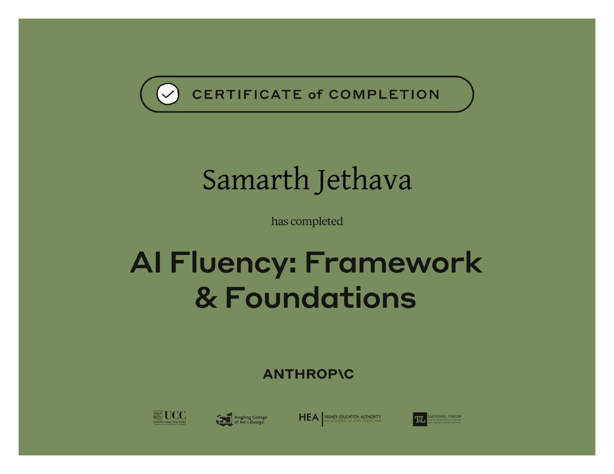

# AI Fluency: Framework & Foundations

 

**Issued by:** Anthropic Education 
**Recipient:** Samarth Jethava

Successfully completed the AI Fluency: Framework & Foundations course, building a foundation for understanding and working effectively with AI.

### What I Learned

- **Understanding AI:** Developed a foundational understanding of AI and how it can support different tasks.
- **AI Capabilities:** Learned to recognize what AI can do and where its limitations may affect results.
- **Effective AI Interaction:** Understood the importance of clear instructions and context when working with AI tools.
- **Critical Evaluation:** Learned to review AI-generated responses instead of accepting every output without checking.
- **Human-AI Collaboration:** Explored how human judgment and AI capabilities can work together to solve problems.

### Verification

**Certificate Link:** https://verify.skilljar.com/c/feqwhqek789w
**Completion Date:** 28th July 2026

### Certificate

