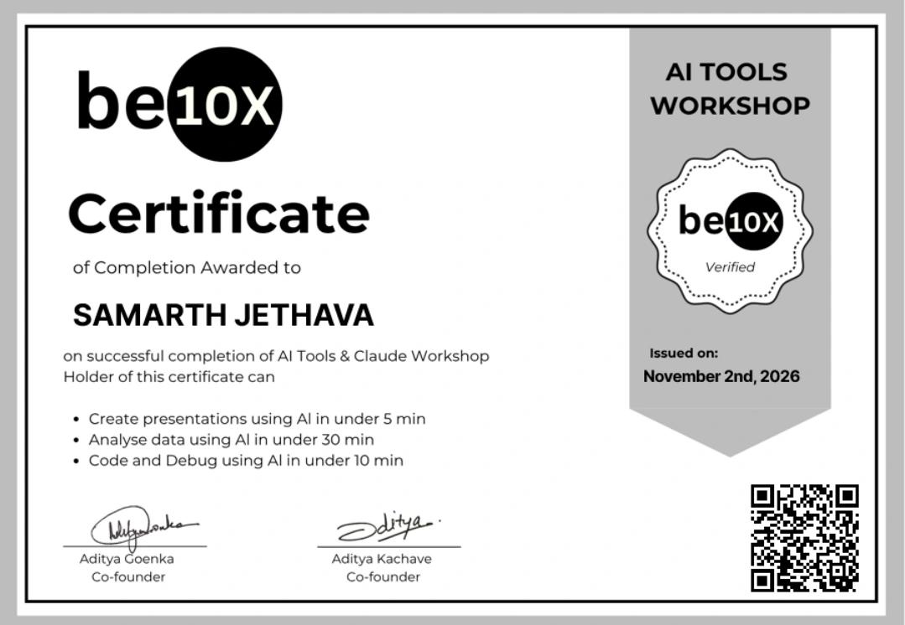

# AI Tools & Claude Workshop
 

**Issued by:** be10x  

Successfully completed the AI Tools & Claude Workshop, focusing on practical ways to use AI for everyday productivity and technical tasks.

### What I Learned

- **AI-Powered Presentations:** Learned to create presentations using AI in under 5 minutes.
- **Data Analysis:** Explored how AI can simplify data analysis and complete tasks in under 30 minutes.
- **Coding with AI:** Learned to use AI tools to assist with writing code and solving programming problems.
- **Debugging:** Explored AI-assisted debugging techniques to identify and resolve coding errors in under 10 minutes.
- **Productivity Workflows:** Understood how AI tools like Claude can reduce repetitive work and make everyday tasks more efficient.

### Verification

Scan the QR code displayed on the original certificate to access its verification information.
 
**Completion Date:** 2th November 2026

### Certificate

